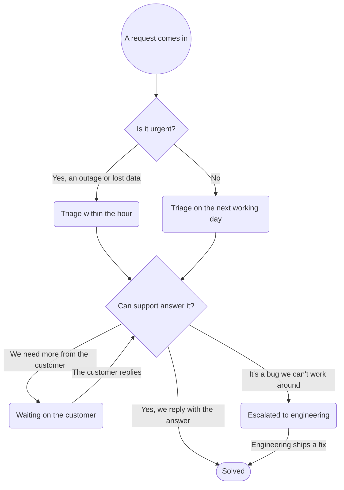

# A support request

The states a request moves through, as the support team works it, each citing the
policy that says what happens there. A fictional team.

```yaml map
version: 1
source: { kind: hub, hub: brightdesk/support }
scope: [""]
nodes:
  - { id: arrives, kind: start, label: A request comes in, cites: [brightdesk/support:/README] }
  - { id: urgent, kind: choice, label: Is it urgent? }
  - id: within-the-hour
    label: Triage within the hour
    cites: [brightdesk/support:/policies/triage]
  - id: next-working-day
    label: Triage on the next working day
    cites: [brightdesk/support:/policies/triage, brightdesk/support:/policies/service-hours]
  - { id: answer, kind: choice, label: Can support answer it? }
  - id: waiting
    label: Waiting on the customer
    cites: [brightdesk/support:/policies/triage]
  - id: escalated
    label: Escalated to engineering
    cites: [brightdesk/support:/policies/escalation]
  - { id: solved, kind: end, label: Solved }
transitions:
  - { from: arrives, to: urgent }
  - { from: urgent, to: within-the-hour, when: "Yes, an outage or lost data" }
  - { from: urgent, to: next-working-day, when: No }
  - { from: within-the-hour, to: answer }
  - { from: next-working-day, to: answer }
  - { from: answer, to: solved, when: "Yes, we reply with the answer" }
  - { from: answer, to: waiting, when: We need more from the customer }
  - { from: answer, to: escalated, when: "It's a bug we can't work around" }
  - { from: waiting, to: answer, when: The customer replies }
  - { from: escalated, to: solved, when: Engineering ships a fix }
pins:
  brightdesk/support:/README: 61b57ca753bb
  brightdesk/support:/policies/triage: edf35bcb698e
  brightdesk/support:/policies/service-hours: 799e6a4d6c72
  brightdesk/support:/policies/escalation: 3a7f439cdf9e
```

<!-- context-kit:diagram:start (generated by `context-kit maps render --write`; do not edit) -->

<!-- context-kit:diagram:end -->
