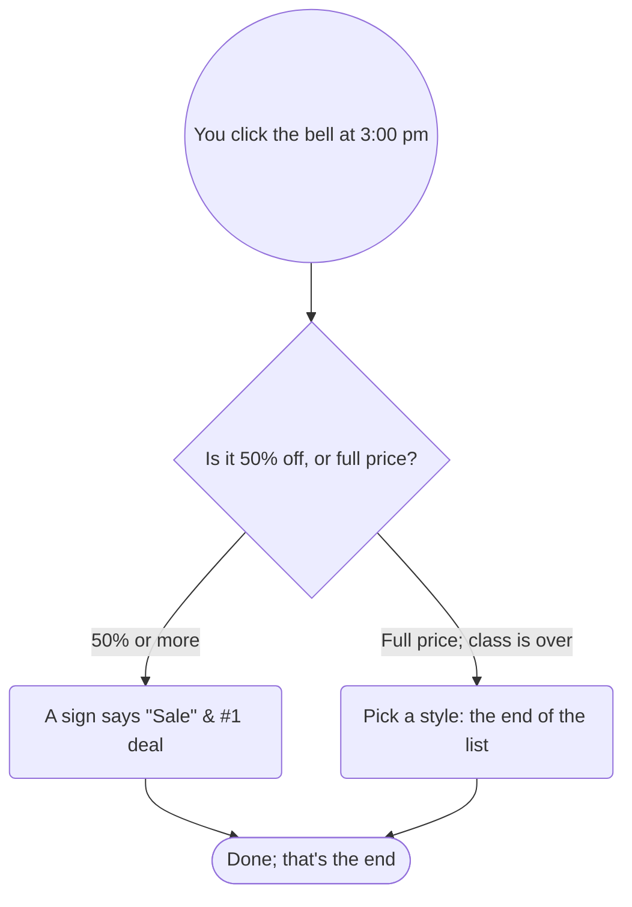

# Labels with characters Mermaid treats specially

Every label must render as written text, never as Mermaid syntax.

```yaml map
version: 1
source: { kind: openspec }
scope: [alerts]
nodes:
  - { id: bell, kind: start, label: "You click the bell at 3:00 pm" }
  - { id: price, kind: choice, label: "Is it 50% off, or full price?" }
  - id: sale
    label: 'A sign says "Sale" & #1 deal'
    cites: [alerts / Mention badge]
  - id: pick
    label: "Pick a style: the end of the list"
    cites: [alerts / Room post without a mention]
  - { id: done, kind: end, label: "Done; that's the end" }
transitions:
  - { from: bell, to: price }
  - { from: price, to: sale, when: "50% or more" }
  - { from: price, to: pick, when: "Full price; class is over" }
  - { from: sale, to: done }
  - { from: pick, to: done }
```

<!-- context-kit:diagram:start (generated by `context-kit maps render --write`; do not edit) -->

<!-- context-kit:diagram:end -->
