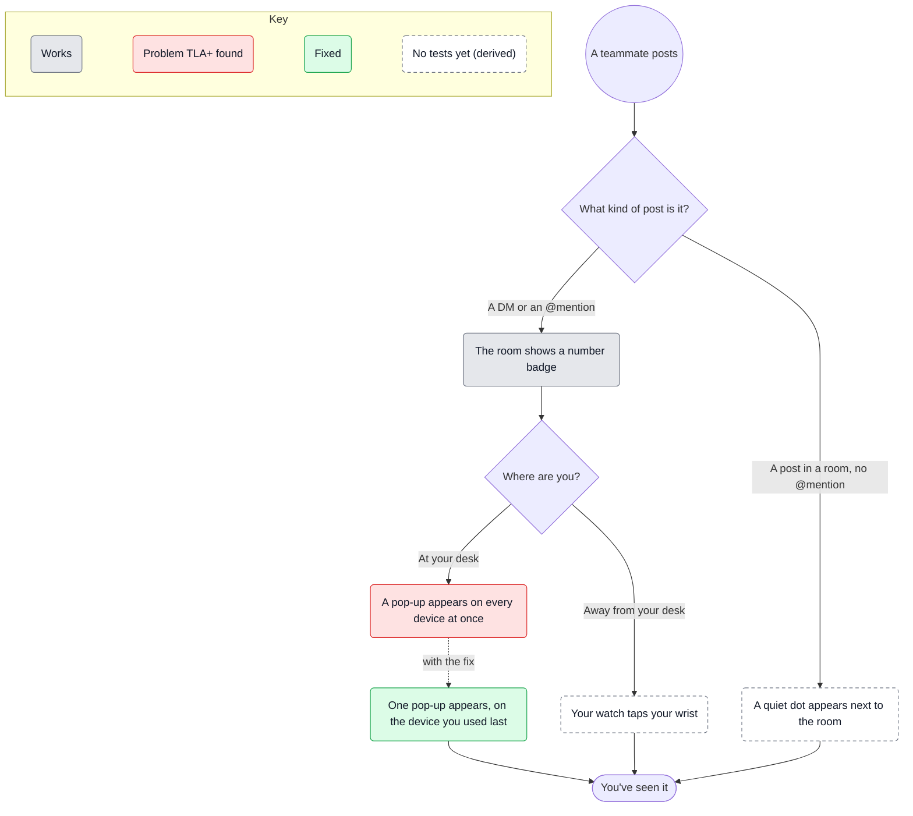

# When a teammate posts

What someone using Pigeon notices after a teammate posts. A fictional example.

```yaml map
version: 1
source: { kind: openspec }
scope: [alerts]
vocabulary: [DM, "@mention"]
nodes:
  - { id: posted, kind: start, label: A teammate posts }
  - { id: what-kind, kind: choice, label: What kind of post is it? }
  - id: dot
    label: A quiet dot appears next to the room
    cites: [alerts / Room post without a mention]
  - id: badge
    label: The room shows a number badge
    cites: [alerts / Mention badge]
    status: { state: works, evidence: ["#198"] }
  - { id: where, kind: choice, label: Where are you? }
  - id: two-popups
    label: A pop-up appears on every device at once
    cites: [alerts / Desktop pop-up]
    status:
      state: issue
      found_by: model-checker
      finder: TLA+
      note: Laptop and tablet both alert when both apps are open
      evidence: [models/Alerts.tla, "#212"]
      fixed_by: one-popup
  - id: one-popup
    label: One pop-up appears, on the device you used last
    cites: [alerts / Single pop-up]
    status: { state: fixed, evidence: ["#231"] }
  - id: watch
    label: Your watch taps your wrist
    cites: [alerts / Away from your desk]
  - { id: seen, kind: end, label: You've seen it }
transitions:
  - { from: posted, to: what-kind }
  - { from: what-kind, to: dot, when: "A post in a room, no @mention" }
  - { from: what-kind, to: badge, when: A DM or an @mention }
  - { from: badge, to: where }
  - { from: where, to: two-popups, when: At your desk }
  - { from: where, to: watch, when: Away from your desk }
  - { from: one-popup, to: seen }
  - { from: watch, to: seen }
  - { from: dot, to: seen }
pins:
  alerts / Room post without a mention: bd11b2c07e66
  alerts / Mention badge: 5c5fa649501a
  alerts / Desktop pop-up: ab5e1a1449bf
  alerts / Single pop-up: eb3dc9a349e1
  alerts / Away from your desk: 7a84c94c1a77
```

<!-- context-kit:diagram:start (generated by `context-kit maps render --write`; do not edit) -->

<!-- context-kit:diagram:end -->

The pop-up on every device was found by a TLA+ model of the pop-up rules
(`models/Alerts.tla`, #212) and fixed in #231: one pop-up now appears, on the
device used last. The badge is known to work from #198.
