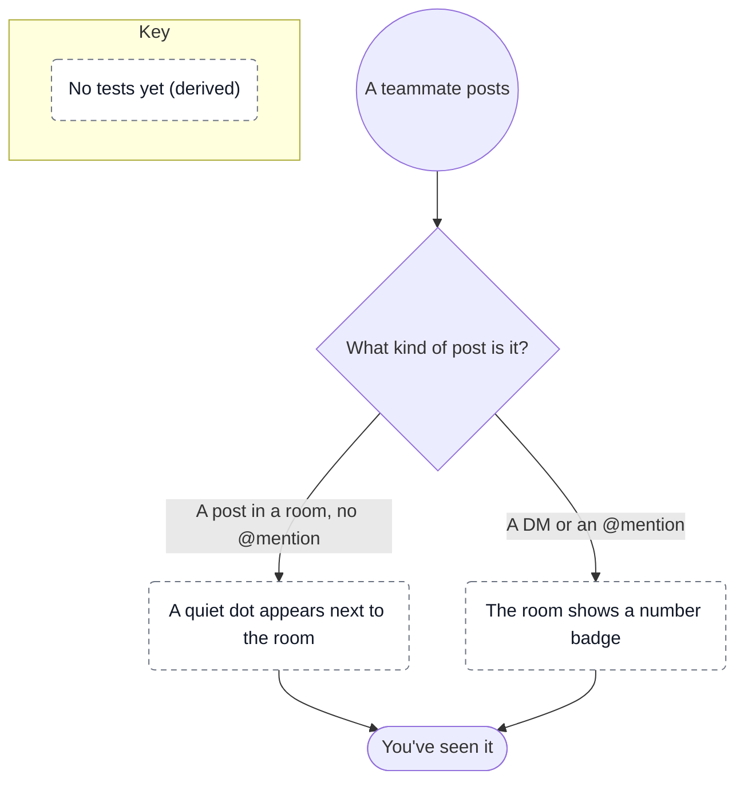

# When a teammate posts

What someone using Pigeon notices after a teammate posts. A fictional example.

```yaml map
version: 1
source: { kind: openspec }
scope: [alerts]
vocabulary: [DM, "@mention"]
nodes:
  - { id: posted, kind: start, label: A teammate posts }
  - { id: what-kind, kind: choice, label: What kind of post is it? }
  - id: dot
    label: A quiet dot appears next to the room
    cites: [alerts / Room post without a mention]
  - id: badge
    label: The room shows a number badge
    cites: [alerts / Mention badge]
  - { id: seen, kind: end, label: You've seen it }
transitions:
  - { from: posted, to: what-kind }
  - { from: what-kind, to: dot, when: "A post in a room, no @mention" }
  - { from: what-kind, to: badge, when: A DM or an @mention }
  - { from: dot, to: seen }
  - { from: badge, to: seen }
pins:
  alerts / Room post without a mention: bd11b2c07e66
  alerts / Mention badge: 5c5fa649501a
```

<!-- context-kit:diagram:start (generated by `context-kit maps render --write`; do not edit) -->

<!-- context-kit:diagram:end -->

The badge clears once the room is opened; that is part of the badge requirement, so
this map does not draw it as its own state.
